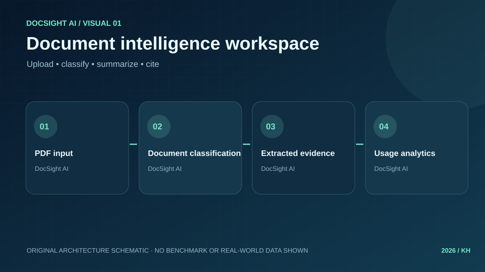
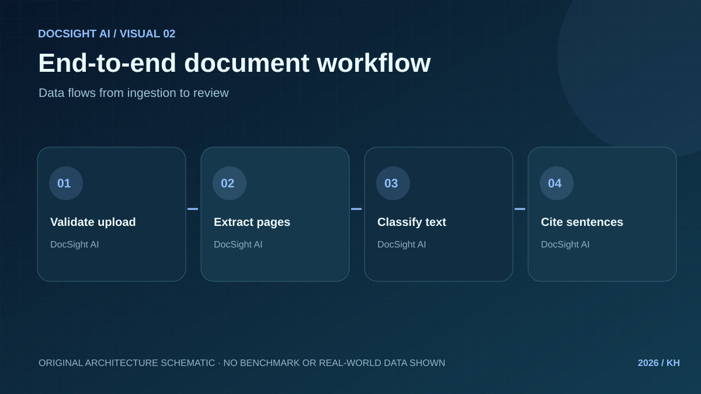
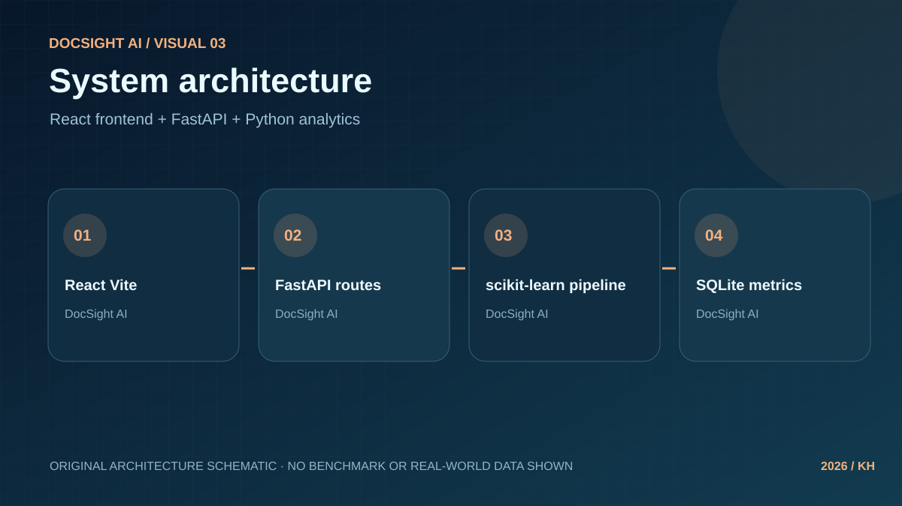
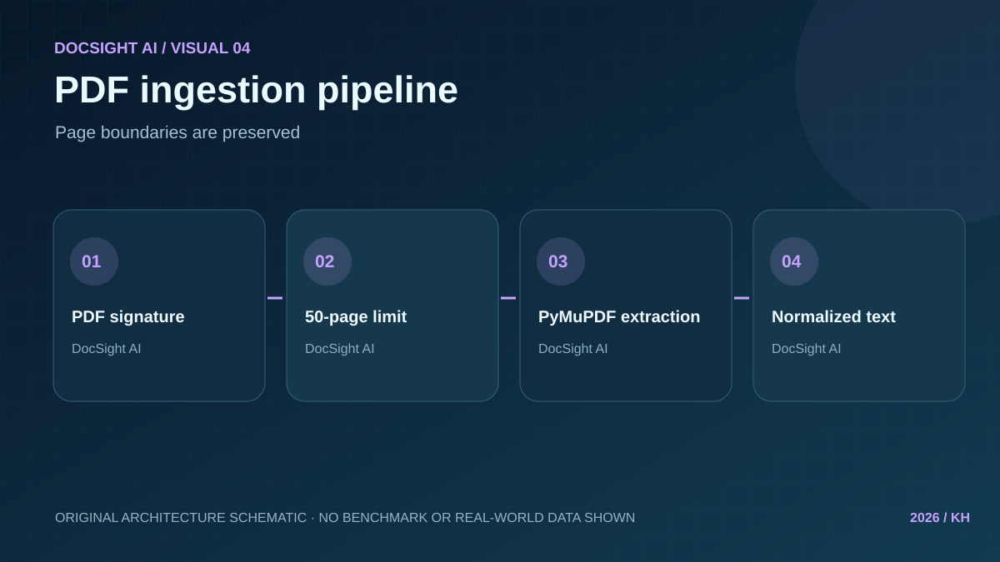
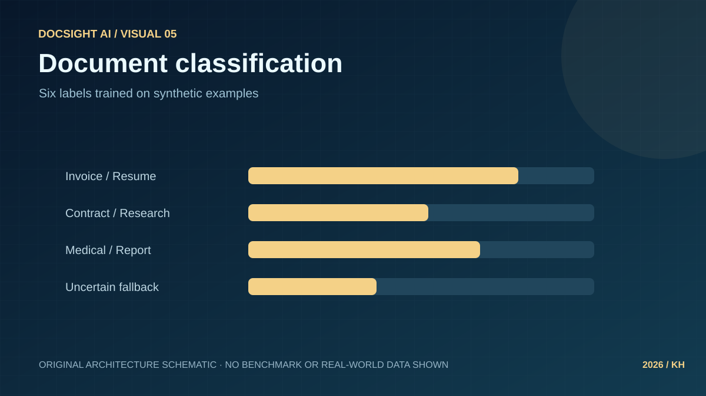
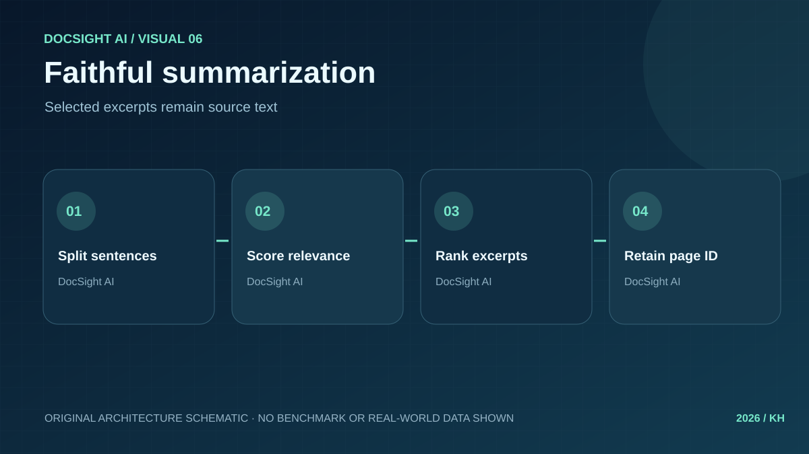
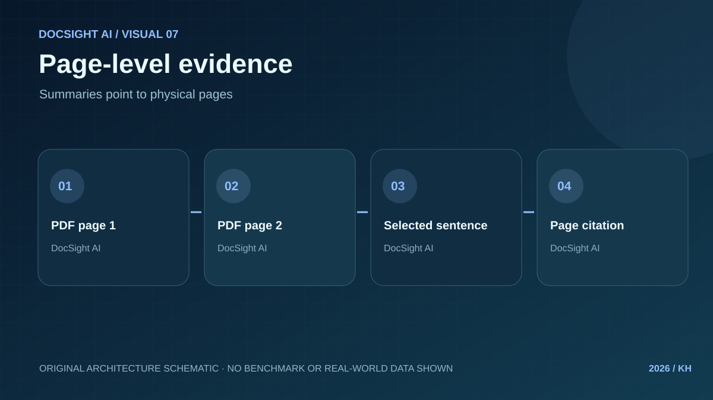
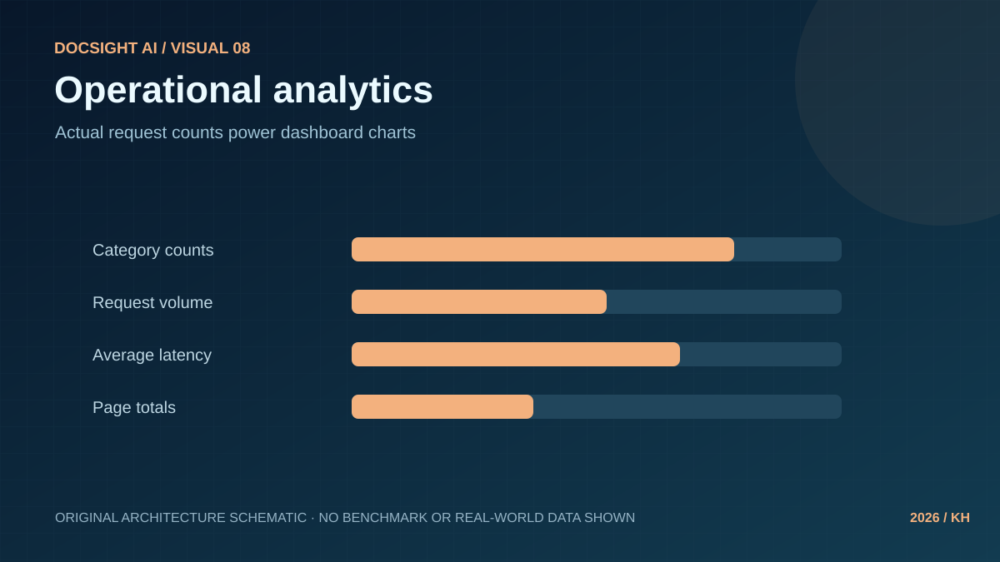
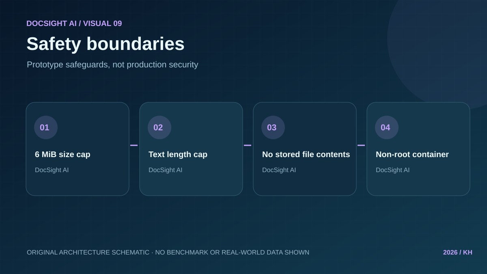
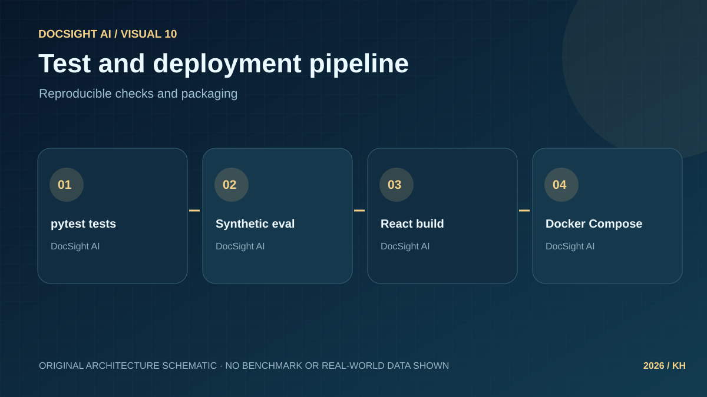

> Historical detailed project guide. The root README and repository inventory describe currently available files; older release notes may refer to external bundles or earlier versions.

# DocSight AI — Smart Document Classifier & Summarizer

A full-stack, local-first document intelligence portfolio application: upload a PDF or text file, predict its category, see extractive highlights with source page numbers, and explore request analytics.

**Transparency:** The classifier is trained on 72 authored synthetic samples across 6 categories, not validated real-world documents. Probabilities are not calibrated. The extractive summarizer returns sentences from the input, not LLM-generated prose. Illustrations are original schematics, not screenshots from a deployed production service.

## Features

| Module | Implementation |
|---|---|
| Ingestion | PyMuPDF PDF parser (selectable text), UTF-8 TXT, original page indexing |
| ML | TF-IDF word ngrams + Logistic Regression; six classes and uncertain fallback |
| Summarization | Sentence ranking with citations to source pages |
| API | FastAPI with input checks, Pydantic schema and OpenAPI docs |
| Web | React/Vite upload interface, sample mode, evidence display, JSON export |
| Analytics | SQLite stores request timing, counts and categories — never uploaded content |
| Engineering | Tests, synthetic evaluation, GitHub Actions, Docker Compose |

## Get running

**Docker (requires Docker Compose):**

~~~bash
docker compose up --build
~~~

Open http://localhost:8080

**Local development (Python 3.11+ and Node.js 20+):**

~~~bash
python -m venv .venv
# Windows: .venv\Scripts\activate
# macOS/Linux: source .venv/bin/activate
pip install -r requirements-dev.txt
uvicorn backend.app.main:app --reload --port 8000
~~~

In a second terminal:

~~~bash
cd frontend
npm install
npm run dev
~~~

Open http://localhost:5173 . API docs: http://localhost:8000/docs

**Test the sample:**

~~~bash
curl -X POST http://localhost:8000/api/v1/analyze -F "file=@data/samples/example_report.txt"
pytest -q
python -m scripts.evaluate
python -m scripts.make_eval_charts
~~~

The evaluation outputs a synthetic held-out classification report and confusion matrix at reports/model_evaluation.json. The chart generator creates reports/confusion_matrix.svg and reports/per_class_f1.svg from those **actual synthetic test results**. All three are ignored by Git and included in the downloadable CI evaluation artifact; none constitute an independent real-world benchmark. Do not confuse synthetic test performance with real-world accuracy.

## Architecture workflow

~~~mermaid
flowchart LR
    A[PDF/TXT upload] --> B{Validate}
    B -->|Valid| C[Page-indexed extraction]
    B -->|Invalid| X[Error response]
    C --> D[Normalized text]
    D --> E[TF-IDF classifier]
    D --> F[Extractive summarizer]
    E --> G[Predicted category]
    F --> H[Source excerpts + page numbers]
    G --> I[FastAPI response]
    H --> I
    I --> J[React application]
    I --> K[SQLite metadata]
    K --> L[Analytics charts]
~~~

## Gallery: 10 original SVG visuals

All visuals below are conceptual schematics, not benchmark graphs or live app screenshots.

| | |
|---|---|
|  |  |
|  |  |
|  |  |
|  |  |
|  |  |

## Source tree

~~~text
Smart-Document-Classifier-Summarizer/
├── .github/workflows/ci.yml
├── assets/ (10 SVG graphics)
├── backend/app/{main.py,routes/,schemas/,services/,db/}
├── src/{ingestion/,preprocessing/,classification/,summarization/,evaluation/,security/}
├── data/samples/
├── frontend/src/
├── tests/
├── scripts/
├── docs/
├── Dockerfile
├── docker-compose.yml
├── requirements.txt
└── README.md
~~~

[System architecture](docs/ARCHITECTURE.md) · [API](docs/API.md) · [Model card](docs/MODEL_CARD.md) · [Security](docs/SECURITY.md) · [Deployment](docs/DEPLOYMENT.md) · [Portfolio case study](docs/PORTFOLIO_CASE_STUDY.md)

**Production gaps:** no authentication, no per-user isolation, no rate limiting, no malware scanner or PDF sandbox, no OCR for scanned files, no production grade monitoring or real-world model validation. Do not upload confidential content to an untrusted instance. GitHub Pages does not host the Python backend.

MIT licensed · 2026.

## Additional validation, privacy checks and demo

- **Try it instantly:** [Open the standalone browser TXT demo](https://harshakavali81-collab.github.io/harshavardhan-portfolio/docsight-demo.html) in your browser. It uses local keyword heuristics, **not** the trained backend classifier. No server is contacted.
- **Evaluate a separately labeled dataset:** [Independent validation guide](docs/REAL_WORLD_VALIDATION.md); run `python -m scripts.evaluate_external private_documents.csv`. This does not certify dataset independence; no individual document text is saved in the output.
- **Operational startup and troubleshooting:** [Operations runbook](docs/OPERATIONS.md) and Windows setup helper `START_WINDOWS.ps1`.
- **API smoke test after starting server:** `python -m scripts.smoke_api http://localhost:8000` (or port 8080 through Docker).
- **Safety checks:** malicious/malformed PDF limits, UTF-8 rejection, filename sanitization and no raw document persistence are tested. Production-grade security remains outstanding.

## Build verification

The CI workflow now includes distinct Python/unit-evaluation, React build and **Docker image build** jobs. Its Docker job verifies the Compose configuration and builds both the backend and frontend containers. The Docker backend image also exposes a local HTTP health check. A successful CI build proves that these steps complete in the runner, **not** that a public production service is deployed.

## Verified Python coverage

A [GitHub Actions CI run](https://github.com/harshakavali81-collab/Smart-Document-Classifier-Summarizer/actions/runs/40659178488) recorded **34 passing tests and 100% statement coverage of the 215 measured statements in `backend/` and `src/`** on October 28, 2026. This does **not** measure browser, scripts, operational security, or real-world classifier accuracy. CI now enforces a **95% minimum** statement coverage threshold for those Python packages.

## Test coverage and production dependencies

Python CI installs requirements-dev.txt and generates a statement-coverage report with pytest-cov. Coverage XML is included in the downloadable CI artifact. Docker installs only runtime requirements.txt. Coverage measures executed source code, not model accuracy or security. See docs/RELEASE_CHECKLIST.md for verification and external approval gates.
